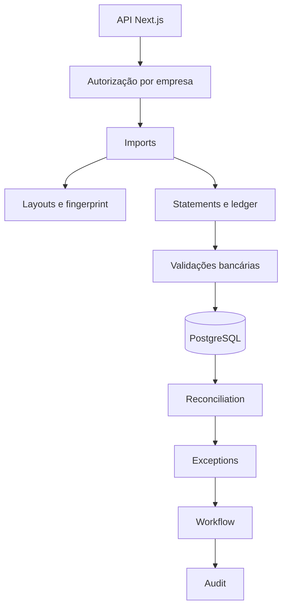

# Reestruturação da conciliação bancária — Design

**Spec**: `.specs/features/bank-reconciliation-restructuring/spec.md`
**Status**: Aprovado

## Arquitetura

O produto permanece um monólito modular TypeScript. Domínio e application services não dependem de
Next.js ou Prisma; repositories e rotas são adapters. O fluxo legado de sessão permanece compatível
durante a migração, mas a API V2 usa os novos casos de uso.

## Componentes

| Componente | Local | Responsabilidade |
| --- | --- | --- |
| Domínio organizacional | `packages/core/src/{companies,accounts,reconciliation}/domain` | Entidades, políticas e invariantes |
| Modelo compartilhado | `packages/core/src/shared/domain` | Decimal, evidência, transação e ledger canônicos |
| Persistência | `packages/core/prisma` e `shared/infrastructure` | PostgreSQL, migrations e repositories |
| Importação | `packages/core/src/imports` | Batch, hash, idempotência, status e orquestração |
| Layouts | `packages/core/src/layouts` e `statements` | Fingerprint, resolução, detector e mapeamento |
| Matching | `packages/core/src/reconciliation` | Cascata e sugestões explicáveis |
| Exceções/workflow | `packages/core/src/{exceptions,workflow,audit}` | Tratamento, estados, papéis e eventos imutáveis |
| API/UI | `apps/web/src` | Entrada validada, autorização e revisão assistida |

## Decisões técnicas

| Decisão | Escolha | Razão |
| --- | --- | --- |
| Persistência | Prisma + PostgreSQL | Já existe Prisma e o PRD recomenda PostgreSQL |
| Dinheiro | `DecimalString` + Decimal.js/Prisma Decimal | Serializável, exato e independente de framework |
| JSON | Tipos estruturados no domínio e `Json` no banco | Preserva evidência sem stringify manual |
| Layout | Versão como registro imutável | Reproduz importações passadas |
| Matching | Engine puro e determinístico | Facilita cobertura, mutation e auditoria |
| Workflow | Máquina de estados explícita | Impede alteração arbitrária de status |

## Reuso

- adapters PDF e catálogo do corpus atuais;
- leitores `tabular/csv-reader.ts` e `spreadsheet-reader.ts`;
- parser Protheus atual;
- gates bancários e regras 1:1 já testadas;
- runtime público existente para manter a experiência atual durante a migração.

## Riscos e mitigação

| Risco | Mitigação |
| --- | --- |
| Árvore de trabalho já alterada | Mudanças cirúrgicas; não restaurar nem apagar alterações prévias |
| Prisma não gera no pnpm atual | Aprovar explicitamente apenas Prisma/engines no workspace |
| Detector genérico permissivo | Remover substring e exigir conteúdo, limiar e margem |
| Dois modelos canônicos | Eleger `shared/domain` e adaptar contratos legados nas bordas |
| Repositories sem testes | In-memory repositories para unit/integration e Prisma como adapter |
| Identidade corporativa indefinida | Contrato de ator/RBAC desacoplado de SSO; adapter externo futuro |
