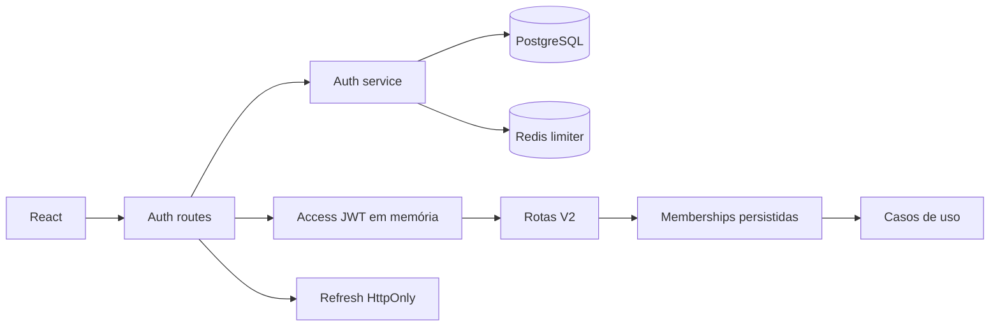

# Autenticação persistente e acesso multicontas - Design

**Spec**: `.specs/features/persistent-authentication/spec.md`
**Status**: Aprovado

## Arquitetura

O módulo `auth` pertence ao core e mantém domínio e aplicação independentes de Next.js. Prisma implementa usuários, memberships e sessões. O adapter web emite JWT padrão, gerencia cookies, valida origem e converte a identidade persistida em `ActorContext` para reutilizar as guardas existentes.

## Modelos

- `User`: identidade, e-mail canônico, hash, status, troca obrigatória e versão de autenticação.
- `OrganizationMembership`: usuário na organização com papel `OWNER`.
- `CompanyAccess`: usuário na projeção operacional da entidade legal, com papéis tipados.
- `AuthSession`: família de refresh, inatividade, limite absoluto e revogação.
- `AuthRefreshToken`: hash de token de uso único, consumo e substituição.
- `Company`: projeção 1:1 de `ConfigLegalEntity`, ligada por `(organizationId, legalEntityId)`.

## Segurança

- `jose` para JWT com `iss`, `aud`, `sub`, `sid`, `iat`, `exp` e `jti`.
- Argon2id por `@node-rs/argon2` 2.0.2, versão madura sem postinstall; nenhuma implementação criptográfica própria.
- refresh opaco aleatório, hash SHA-256 no banco e rotação em transação serializável.
- access JWT não carrega papéis; autorização consulta memberships atuais.
- cookie com escopo `/api/auth`, `HttpOnly`, `SameSite=Lax` e `Secure` em produção.
- validação de `Origin` em refresh/logout e mudanças autenticadas por cookie.

## Reuso

| Componente | Local | Reuso |
| --- | --- | --- |
| `ActorContext` e `assertCompanyRole` | `packages/core/src/shared/domain/Authorization.ts` | Guardas de workflow |
| Prisma singleton | `packages/core/src/database.ts` | Persistência transacional |
| Token opaco/hash | `packages/runtime/src/session-store.ts` | Princípio, não armazenamento |
| Erros V2 | `apps/web/src/lib/v2-auth.ts` | Contrato HTTP consistente |
| Configuração tenant-aware | `apps/web/src/lib/configuration-api.ts` | Integração administrativa |

## Riscos e mitigação

| Risco | Evidência | Mitigação |
| --- | --- | --- |
| Dois modelos de empresa | `schema.prisma` contém `Company` e `ConfigLegalEntity` | vínculo explícito 1:1 e criação transacional |
| Papéis no token legado ficam obsoletos | `apps/web/src/lib/v2-auth.ts` | JWT contém identidade/sessão; banco é autoritativo |
| Rate limit atual não é aplicado | `apps/web/src/app/api/sessions/route.ts` | limiter Redis atômico nas novas rotas |
| Drift entre schema e migration de configuração | `ConfigInheritanceOverride` | alinhar schema antes da migration auth |
| Worktree extensamente alterado | `git status` | mudanças aditivas; não restaurar alterações prévias |

## Decisões técnicas

| Tema | Escolha | Razão |
| --- | --- | --- |
| JWT | `jose` | padrão mantido e validação completa |
| Senha | `@node-rs/argon2` com Argon2id | função adequada para senha, binários por plataforma e sem postinstall |
| Refresh | opaco e stateful | revogação, rotação e replay confiáveis |
| Autorização | consulta persistida por request | alteração de papel tem efeito imediato |
| Rate limit | Redis + script Lua | check/increment/TTL atômicos entre instâncias |
