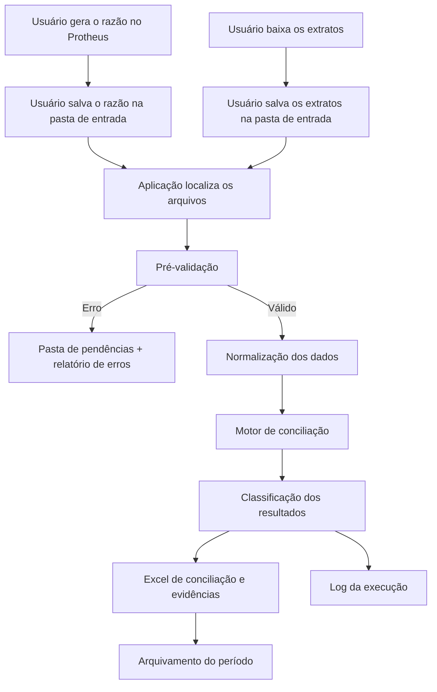

# PRD — Automação de Conciliação Bancária por Arquivos

> **Documento base do projeto**  
> **Versão:** 1.0  
> **Status:** Proposta para refinamento técnico e validação com a área contábil  
> **Produto:** Automação de Conciliação Bancária  
> **Público-alvo:** Contabilidade, Controladoria, Auditoria, TI e equipe de desenvolvimento  
> **Premissa principal:** o usuário disponibiliza manualmente o razão do Protheus e os extratos bancários em uma pasta padronizada; a aplicação processa os arquivos e gera um relatório detalhado, sem banco de dados.

---

## 1. Resumo executivo

O projeto tem como objetivo automatizar a conciliação entre:

- os lançamentos contábeis extraídos do **razão do Protheus**; e
- as movimentações presentes nos **extratos bancários**.

A automação não será responsável por acessar o Protheus, portais bancários, APIs ou páginas web. O processo começa quando os arquivos já foram disponibilizados pelo usuário em uma pasta de entrada.

A aplicação deverá:

1. localizar os arquivos na estrutura padronizada;
2. validar presença, formato, período e integridade;
3. converter os diferentes layouts para um modelo interno comum;
4. executar as regras de conciliação;
5. classificar cada lançamento;
6. gerar um arquivo Excel com resumo, conciliações e divergências detalhadas;
7. manter rastreabilidade dos arquivos e linhas que originaram cada resultado;
8. arquivar os arquivos utilizados e registrar logs da execução.

O foco principal não é apenas informar a quantidade ou o total das divergências. Cada divergência deve ser **evidenciada individualmente**, apresentando os dados do razão, os dados do extrato, a diferença encontrada, a regra aplicada e a origem de cada informação.

---

## 2. Contexto e problema

O processo atual de conciliação exige comparação manual entre relatórios contábeis e comprovantes bancários. Esse modelo apresenta alguns problemas:

- elevado esforço operacional;
- risco de erro humano;
- baixa rastreabilidade;
- dificuldade para identificar a origem de uma diferença;
- revisão manual de lançamentos que já poderiam ser conciliados automaticamente;
- dependência de conhecimento individual;
- formatos bancários diferentes;
- dificuldade para demonstrar as evidências a revisores e auditores.

A necessidade do projeto não é criar um sistema contábil completo, mas uma ferramenta simples que transforme um processo repetitivo em um processo orientado por exceções.

### 2.1 Mudança de lógica operacional

O processo atual tende a ser:

```text
Analista confere todos os lançamentos
        ↓
Identifica manualmente o que está correto
        ↓
Procura as divergências
```

O processo proposto será:

```text
Automação compara todos os lançamentos
        ↓
Classifica o que foi conciliado
        ↓
Analista atua somente nas exceções
```

Essa mudança reduz o esforço manual sem retirar do analista a responsabilidade sobre decisões contábeis.

---

## 3. Objetivos do produto

### 3.1 Objetivo principal

Automatizar a comparação entre o razão do Protheus e os extratos bancários, gerando um relatório detalhado de conciliações e divergências com rastreabilidade completa.

### 3.2 Objetivos específicos

- eliminar atividades de comparação repetitiva;
- padronizar o recebimento dos arquivos;
- identificar arquivos ausentes, duplicados ou inválidos;
- reduzir o tempo de fechamento;
- evidenciar cada divergência em nível de lançamento;
- evitar que a aplicação dependa de acesso direto ao Protheus ou aos bancos;
- permitir manutenção simples, sem banco de dados;
- gerar um pacote de evidências por empresa e período;
- garantir que os totais do resumo sejam rastreáveis aos registros detalhados;
- permitir expansão futura para novos bancos e layouts.

### 3.3 Resultados esperados

- maior percentual de conciliação automática;
- menor tempo gasto em conferência manual;
- redução de erros;
- visibilidade das pendências;
- melhor capacidade de revisão;
- evidências prontas para auditoria;
- processo repetível e documentado.

---

## 4. Princípios de implementação

### 4.1 Simplicidade antes de complexidade

O MVP não utilizará:

- banco de dados;
- aplicação web;
- Power BI;
- API do Protheus;
- API bancária;
- RPA;
- autenticação;
- workflow de aprovação;
- armazenamento centralizado de histórico.

Esses elementos só devem ser considerados quando uma necessidade real justificar a complexidade adicional.

### 4.2 Arquivos como interface do processo

Os arquivos serão o contrato entre o usuário e a automação:

- entrada: razão, extratos e configuração;
- saída: relatório Excel, log e arquivos arquivados.

Essa abordagem reduz dependências técnicas e facilita a implantação.

### 4.3 Conciliação orientada por evidência

A aplicação não deve apenas indicar que existe uma divergência. Ela deve mostrar:

- o registro do razão;
- o registro do extrato;
- os valores comparados;
- as datas comparadas;
- o documento comparado;
- a diferença encontrada;
- a regra aplicada;
- os arquivos de origem;
- a linha ou identificador de origem.

### 4.4 Nenhuma decisão arbitrária

Quando houver mais de uma possível correspondência, a aplicação não deve escolher uma delas sem segurança. O item deve ser classificado como ambíguo e enviado para análise manual.

### 4.5 Configuração fora do código

Parâmetros de contas, tolerâncias e relacionamentos devem ficar em uma planilha de configuração. Alterações operacionais não devem exigir mudança de código sempre que possível.

---

## 5. Escopo

## 5.1 Escopo do MVP

O MVP deverá:

- ler razão em XLSX ou CSV;
- ler extratos em OFX, XLSX ou CSV;
- localizar os arquivos em pastas padronizadas;
- validar nomenclatura, período, formato e estrutura;
- relacionar conta contábil e conta bancária;
- normalizar os dados;
- executar conciliação exata;
- executar conciliação com tolerância de data;
- identificar divergência de valor;
- identificar lançamento do razão sem correspondência;
- identificar movimento do extrato sem correspondência;
- identificar duplicidades e ambiguidades;
- gerar Excel detalhado;
- registrar arquivos processados;
- gerar log técnico;
- mover arquivos processados e rejeitados para as pastas correspondentes;
- permitir reprocessamento controlado.

## 5.2 Fora do escopo do MVP

Não fazem parte da primeira versão:

- acesso automático ao Protheus;
- download automático de extratos;
- captura por RPA;
- leitura de PDF;
- OCR;
- gravação automática de ajustes no Protheus;
- baixa contábil automática;
- aprovação eletrônica;
- assinatura digital;
- portal web;
- gestão multiusuário;
- histórico em banco de dados;
- dashboard em tempo real;
- conciliação de clientes, fornecedores, tributos, folha, provisões e imobilizado;
- regras complexas de agrupamento de muitos para muitos;
- inteligência artificial para decidir correspondências;
- envio automático de e-mails.

Esses itens poderão ser avaliados em fases posteriores.

---

## 6. Usuários e responsabilidades

### 6.1 Analista contábil

Responsável por:

- gerar o razão no Protheus;
- baixar ou receber os extratos;
- salvar os arquivos na pasta correta;
- informar o período;
- iniciar a aplicação;
- analisar divergências;
- preencher justificativas;
- solicitar ou executar regularizações;
- aprovar o resultado do período.

### 6.2 Revisor ou coordenador

Responsável por:

- revisar as divergências;
- validar justificativas;
- confirmar a conclusão da conciliação;
- garantir que os saldos e evidências estejam adequados.

### 6.3 Desenvolvimento

Responsável por:

- implantar a aplicação;
- criar novos adaptadores de layout;
- corrigir falhas técnicas;
- manter a planilha de configuração;
- versionar o código;
- executar testes;
- manter documentação técnica.

---

## 7. Visão geral da solução



---

## 8. Arquitetura proposta

A aplicação será dividida em módulos independentes.

### 8.1 Localizador de arquivos

Responsável por:

- procurar os arquivos nas pastas;
- classificar razão e extratos;
- validar nomes;
- evitar leitura de arquivos temporários;
- detectar arquivos duplicados;
- identificar o período.

**Por que implementar assim:** separar a descoberta dos arquivos da lógica de conciliação evita que alterações na organização das pastas afetem todo o processamento.

### 8.2 Validadores

Responsáveis por:

- validar colunas obrigatórias;
- validar formatos;
- validar datas;
- validar valores;
- validar conta bancária;
- validar empresa e filial;
- validar período;
- validar duplicidades;
- verificar se o arquivo está vazio;
- verificar consistência de saldos quando possível.

**Por que implementar assim:** é melhor interromper ou sinalizar um arquivo inválido antes de gerar divergências falsas.

### 8.3 Adaptadores de entrada

Cada formato possui um adaptador:

- adaptador do razão;
- adaptador OFX;
- adaptador CSV bancário;
- adaptador XLSX bancário.

Todos convertem os dados para o mesmo modelo interno.

**Por que implementar assim:** os layouts podem variar, mas o motor de conciliação deve trabalhar sempre com uma estrutura comum.

### 8.4 Motor de conciliação

Responsável por:

- comparar lançamentos;
- aplicar regras em ordem de prioridade;
- impedir reaproveitamento indevido de um lançamento;
- classificar resultados;
- registrar a regra aplicada;
- gerar candidatos em casos de divergência.

**Por que implementar assim:** a lógica de negócio fica centralizada e testável, sem depender do formato original dos arquivos.

### 8.5 Gerador de evidências

Responsável por:

- criar o Excel final;
- montar o resumo;
- detalhar divergências;
- criar links para os arquivos;
- registrar linha e origem;
- conferir os totais;
- criar uma aba de erros técnicos.

**Por que implementar assim:** o output é o principal produto da aplicação e precisa ser compreensível sem consultar o código.

### 8.6 Arquivador e log

Responsável por:

- mover arquivos processados;
- mover arquivos inválidos;
- criar pastas por período;
- registrar data, hora, arquivos e resultado;
- permitir auditoria da execução.

**Por que implementar assim:** sem banco de dados, a organização dos arquivos e logs assume o papel de histórico operacional.

---

## 9. Estrutura de pastas

```text
\\rede\conciliacao\
│
├── 01_Entrada\
│   ├── Razao\
│   └── Extratos\
│
├── 02_Processados\
│   └── AAAA-MM\
│       ├── Razao\
│       └── Extratos\
│
├── 03_Pendencias\
│   └── AAAA-MM\
│
├── 04_Resultados\
│   └── AAAA-MM\
│       ├── CONCILIACAO_EMPRESA_AAAAMM.xlsx
│       ├── LOG_PROCESSAMENTO_AAAAMM.txt
│       └── Evidencias\
│
└── 05_Configuracao\
    └── CONFIGURACAO_CONTAS.xlsx
```

### 9.1 Motivo da separação

- `01_Entrada`: contém somente arquivos ainda não processados;
- `02_Processados`: mantém os arquivos usados com sucesso;
- `03_Pendencias`: recebe arquivos inválidos;
- `04_Resultados`: concentra o relatório e as evidências;
- `05_Configuracao`: contém parâmetros operacionais.

Manter tudo em uma única pasta aumentaria o risco de duplicidade, reprocessamento e perda de rastreabilidade.

---

## 10. Convenção de nomes

### 10.1 Razão

```text
RAZAO_EMPRESA_FILIAL_AAAAMM.xlsx
```

Exemplo:

```text
RAZAO_SPREAD_MATRIZ_202607.xlsx
```

### 10.2 Extrato

```text
EXTRATO_BANCO_AGENCIA_CONTA_AAAAMM.extensao
```

Exemplos:

```text
EXTRATO_ITAU_1234_567890_202607.ofx
EXTRATO_BRADESCO_2345_987654_202607.xlsx
EXTRATO_SANTANDER_3456_112233_202607.csv
```

### 10.3 Resultado

```text
CONCILIACAO_EMPRESA_AAAAMM.xlsx
```

### 10.4 Regras de nomenclatura

- não usar espaços;
- não usar acentos;
- não usar `/`, `\`, `:`, `*`, `?`, `"`, `<`, `>` ou `|`;
- usar sempre o período no formato `AAAAMM`;
- manter agência e conta sem caracteres especiais;
- utilizar somente formatos aprovados.

**Por que padronizar:** o nome do arquivo permite identificar o conteúdo antes de abri-lo, simplificando a validação.

---

## 11. Planilha de configuração

Arquivo:

```text
05_Configuracao\CONFIGURACAO_CONTAS.xlsx
```

### 11.1 Aba `Contas`

| Campo | Obrigatório | Exemplo | Finalidade |
|---|---|---|---|
| Empresa | Sim | SPREAD | Identificar a entidade |
| Filial | Sim | MATRIZ | Identificar a filial |
| Conta contábil | Sim | 1.1.1.01.001 | Relacionar com o razão |
| Descrição | Sim | Banco Itaú | Exibição no relatório |
| Banco | Sim | ITAU | Identificar o extrato |
| Agência | Sim | 1234 | Relacionar a conta bancária |
| Conta bancária | Sim | 567890 | Relacionar a conta bancária |
| Formato aceito | Sim | OFX | Definir o adaptador |
| Tolerância de data | Sim | 2 | Permitir diferença controlada |
| Tolerância de valor | Sim | 0,01 | Definir diferença aceitável |
| Regra principal | Sim | DOC_VALOR_DATA | Selecionar estratégia |
| Ativa | Sim | SIM | Controlar uso |
| Responsável | Não | Contabilidade | Controle operacional |

### 11.2 Aba `Layouts`

Opcional no MVP, recomendada quando houver vários modelos de Excel ou CSV.

| Campo | Exemplo |
|---|---|
| Código do layout | BRADESCO_XLSX_01 |
| Tipo | EXTRATO |
| Coluna de data | DATA |
| Coluna de documento | DOCUMENTO |
| Coluna de histórico | HISTORICO |
| Coluna de débito | DEBITO |
| Coluna de crédito | CREDITO |
| Coluna de valor | VALOR |
| Separador CSV | `;` |
| Codificação | UTF-8 |

### 11.3 Aba `Parametros`

| Parâmetro | Exemplo |
|---|---|
| Período padrão | 202607 |
| Tolerância geral de valor | 0,01 |
| Tolerância geral de data | 2 |
| Permitir reprocessamento | NÃO |
| Diretório de entrada | `\\rede\conciliacao\01_Entrada` |
| Diretório de resultado | `\\rede\conciliacao\04_Resultados` |

**Por que usar Excel:** permite alteração pela área responsável sem necessidade de banco de dados ou tela administrativa.

---

## 12. Especificação dos arquivos de entrada

## 12.1 Razão do Protheus

O razão deverá conter, no mínimo:

| Campo interno | Obrigatório | Observação |
|---|---|---|
| Empresa | Sim | Código ou nome padronizado |
| Filial | Sim | Código ou nome padronizado |
| Conta contábil | Sim | Sem formatação inconsistente |
| Data | Sim | Data do lançamento |
| Documento | Recomendado | Chave importante |
| Histórico | Recomendado | Apoio à análise |
| Débito | Sim, quando aplicável | Valor positivo |
| Crédito | Sim, quando aplicável | Valor positivo |
| Valor líquido | Calculado | Crédito menos débito ou padrão definido |
| Identificador | Recomendado | ID do Protheus |
| Centro de custo | Não | Quando necessário |
| Linha de origem | Gerado pela aplicação | Número da linha do arquivo |

### 12.1.1 Regras para o razão

- o arquivo deve conter somente o período solicitado ou possuir coluna de data;
- as colunas devem seguir o layout aprovado;
- valores devem ser numéricos;
- contas devem existir na configuração;
- registros sem conta, data ou valor devem ser rejeitados;
- o arquivo não pode estar vazio;
- a aplicação deve registrar totais de débito e crédito.

## 12.2 Extratos bancários

Formatos aceitos no MVP:

1. OFX;
2. CSV estruturado;
3. XLSX estruturado.

Campos internos esperados:

| Campo interno | Obrigatório | Observação |
|---|---|---|
| Banco | Sim | Derivado do arquivo ou configuração |
| Agência | Sim | Deve corresponder ao cadastro |
| Conta bancária | Sim | Deve corresponder ao cadastro |
| Data | Sim | Data da movimentação |
| Documento | Recomendado | Pode estar ausente |
| Histórico | Recomendado | Apoio à análise |
| Valor | Sim | Positivo ou negativo |
| Natureza | Derivada | Débito ou crédito |
| Saldo | Não | Quando disponível |
| Identificador bancário | Recomendado | Ex.: FITID do OFX |
| Linha de origem | Gerada | Linha ou posição no arquivo |
| Arquivo de origem | Gerado | Nome completo |

### 12.2.1 Regras para extratos

- agência e conta devem estar cadastradas;
- o período deve ser compatível;
- o arquivo deve conter movimentações;
- registros sem data ou valor devem ser rejeitados;
- valores devem ser convertidos para o padrão interno;
- crédito e débito devem possuir sinais consistentes;
- quando houver saldo inicial e final, a aplicação deve verificar a equação do extrato;
- arquivos não reconhecidos devem ser enviados para pendências.

---

## 13. Modelo interno de dados

Após a leitura, razão e extrato devem ser convertidos para estruturas padronizadas.

### 13.1 Registro normalizado do razão

```text
empresa
filial
conta_contabil
data
documento
historico
valor
natureza
identificador_origem
arquivo_origem
linha_origem
```

### 13.2 Registro normalizado do extrato

```text
banco
agencia
conta_bancaria
data
documento
historico
valor
natureza
identificador_origem
arquivo_origem
linha_origem
```

### 13.3 Motivo da normalização

O motor de conciliação não deve conhecer detalhes específicos do Itaú, Bradesco, Santander ou do arquivo original do Protheus. Ele deve receber registros padronizados e aplicar regras comuns.

---

## 14. Regras de conciliação

As regras devem ser executadas em ordem, da mais segura para a menos segura.

### 14.1 Regra 1 — Correspondência exata

Critérios:

- mesma conta relacionada;
- mesma data;
- mesmo valor;
- mesmo documento.

Resultado:

```text
CONCILIADO_EXATO
```

**Por que aplicar primeiro:** possui maior segurança e reduz o universo das regras seguintes.

### 14.2 Regra 2 — Documento e valor com tolerância de data

Critérios:

- mesma conta;
- mesmo documento;
- mesmo valor;
- diferença de data dentro da tolerância configurada.

Resultado:

```text
CONCILIADO_TOLERANCIA_DATA
```

Exemplo:

```text
Razão:   28/07/2026 — Documento 15487 — R$ 1.500,00
Extrato: 29/07/2026 — Documento 15487 — R$ 1.500,00
Tolerância: 2 dias
```

### 14.3 Regra 3 — Valor e data sem documento

Aplicável quando o documento bancário estiver ausente.

Critérios:

- mesma conta;
- mesmo valor;
- mesma data ou data dentro da tolerância;
- apenas uma correspondência possível.

Resultado:

```text
CONCILIADO_VALOR_DATA
```

**Controle:** se houver mais de uma possibilidade, o item será ambíguo.

### 14.4 Regra 4 — Possível correspondência com valor divergente

Critérios:

- mesmo documento ou alta compatibilidade de referência;
- data igual ou próxima;
- valor diferente.

Resultado:

```text
DIVERGENCIA_VALOR
```

A aplicação deve apresentar os dois registros lado a lado.

### 14.5 Regra 5 — Data fora da tolerância

Critérios:

- mesmo documento;
- mesmo valor;
- diferença de data maior que a permitida.

Resultado:

```text
DIVERGENCIA_DATA
```

### 14.6 Regra 6 — Razão sem extrato

Quando nenhum movimento bancário correspondente for encontrado.

Resultado:

```text
RAZAO_SEM_EXTRATO
```

### 14.7 Regra 7 — Extrato sem razão

Quando nenhum lançamento contábil correspondente for encontrado.

Resultado:

```text
EXTRATO_SEM_RAZAO
```

### 14.8 Regra 8 — Ambiguidade

Quando um lançamento possuir mais de uma correspondência possível.

Resultado:

```text
MULTIPLAS_CORRESPONDENCIAS
```

A aplicação não deverá escolher automaticamente.

### 14.9 Regra 9 — Duplicidade

Quando o mesmo identificador ou combinação de dados aparecer repetidamente de forma indevida.

Resultado:

```text
POSSIVEL_DUPLICIDADE
```

### 14.10 Agrupamentos

Agrupamentos de um para vários ou vários para um poderão ser incluídos em uma fase posterior.

Para o MVP, apenas agrupamentos simples e previamente autorizados devem ser considerados. Qualquer agrupamento automático deve:

- mostrar todos os itens envolvidos;
- provar que a soma corresponde;
- impedir que um item seja usado em mais de um agrupamento;
- registrar a regra aplicada.

---

## 15. Classificação dos resultados

| Status | Significado |
|---|---|
| `CONCILIADO_EXATO` | Todos os campos principais correspondem |
| `CONCILIADO_TOLERANCIA_DATA` | Valor e documento iguais, data dentro da tolerância |
| `CONCILIADO_VALOR_DATA` | Documento ausente, correspondência única por valor e data |
| `DIVERGENCIA_VALOR` | Possível correspondência com valores diferentes |
| `DIVERGENCIA_DATA` | Possível correspondência com data fora da tolerância |
| `RAZAO_SEM_EXTRATO` | Lançamento contábil sem movimento bancário |
| `EXTRATO_SEM_RAZAO` | Movimento bancário sem contabilização |
| `MULTIPLAS_CORRESPONDENCIAS` | Mais de um candidato possível |
| `POSSIVEL_DUPLICIDADE` | Registro possivelmente duplicado |
| `ERRO_DE_DADOS` | Registro inválido ou incompleto |
| `ARQUIVO_REJEITADO` | Arquivo não processado |

---

## 16. Output da aplicação

O output principal será:

```text
CONCILIACAO_EMPRESA_AAAAMM.xlsx
```

## 16.1 Aba `Resumo`

Deve apresentar:

| Campo |
|---|
| Empresa |
| Filial |
| Conta contábil |
| Banco |
| Agência |
| Conta bancária |
| Saldo do razão |
| Saldo do extrato |
| Diferença de saldo |
| Quantidade conciliada |
| Valor conciliado |
| Quantidade de divergências |
| Valor das divergências |
| Quantidade sem extrato |
| Quantidade sem razão |
| Status da conta |
| Data e hora da execução |

### Regra de rastreabilidade

Todo número apresentado no resumo deve ser obtido a partir das abas detalhadas.

```text
Total de divergências do resumo
=
Quantidade de linhas classificadas como divergência
```

## 16.2 Aba `Conciliados`

Campos mínimos:

| Campo |
|---|
| ID da conciliação |
| Conta contábil |
| Banco/agência/conta |
| Data do razão |
| Data do extrato |
| Documento do razão |
| Documento do extrato |
| Histórico do razão |
| Histórico do extrato |
| Valor do razão |
| Valor do extrato |
| Diferença |
| Regra aplicada |
| Arquivo do razão |
| Linha do razão |
| Arquivo do extrato |
| Linha ou ID do extrato |

## 16.3 Aba `Divergencias_Detalhadas`

Cada divergência deverá ocupar uma linha e conter:

| Campo |
|---|
| ID da divergência |
| Tipo de divergência |
| Empresa |
| Filial |
| Conta contábil |
| Banco |
| Agência |
| Conta bancária |
| Data do razão |
| Documento do razão |
| Histórico do razão |
| Valor do razão |
| Arquivo do razão |
| Linha do razão |
| Data do extrato |
| Documento do extrato |
| Histórico do extrato |
| Valor do extrato |
| Arquivo do extrato |
| Linha ou identificador do extrato |
| Diferença de valor |
| Diferença em dias |
| Tolerância permitida |
| Regra avaliada |
| Motivo da divergência |
| Status da análise |
| Justificativa do analista |
| Ação necessária |
| Responsável |
| Prazo |
| Data de regularização |
| Conclusão |

## 16.4 Aba `Razao_Sem_Extrato`

Deve listar integralmente os lançamentos contábeis não encontrados no extrato.

## 16.5 Aba `Extrato_Sem_Razao`

Deve listar integralmente os movimentos bancários não encontrados no razão.

## 16.6 Aba `Ambiguidades`

Deve listar:

- lançamento principal;
- candidatos encontrados;
- critérios correspondentes;
- motivo pelo qual a aplicação não decidiu.

## 16.7 Aba `Arquivos_Processados`

Campos:

| Campo |
|---|
| Nome do arquivo |
| Tipo |
| Empresa |
| Banco |
| Agência |
| Conta |
| Período |
| Quantidade de registros |
| Total de débito |
| Total de crédito |
| Hash do arquivo |
| Data e hora |
| Situação |

## 16.8 Aba `Erros_Tecnicos`

Campos:

| Campo |
|---|
| Arquivo |
| Etapa |
| Código do erro |
| Descrição |
| Registro ou linha |
| Orientação ao usuário |
| Data e hora |

---

## 17. Evidência das divergências

### 17.1 Identificador único

Cada divergência terá um ID:

```text
DIV-AAMM-BANCO-000001
```

Exemplo:

```text
DIV-2607-ITAU-000001
```

### 17.2 Evidência mínima

Para cada divergência, devem ser apresentados:

- os dados originais do razão;
- os dados originais do extrato;
- a origem de cada registro;
- a diferença;
- a regra que falhou;
- a tolerância aplicada;
- a classificação;
- o campo para tratamento humano.

### 17.3 Exemplo

```text
ID: DIV-2607-ITAU-000001
Tipo: DIVERGENCIA_VALOR

Razão:
Data: 28/07/2026
Documento: 15487
Histórico: PAGAMENTO FORNECEDOR ABC
Valor: -1.500,00
Arquivo: RAZAO_SPREAD_MATRIZ_202607.xlsx
Linha: 1254

Extrato:
Data: 29/07/2026
Documento: 15487
Histórico: PAGTO FORNECEDOR ABC
Valor: -1.450,00
Arquivo: EXTRATO_ITAU_1234_567890_202607.ofx
ID bancário: 875421

Resultado:
Documento compatível: Sim
Data dentro da tolerância: Sim
Valor compatível: Não
Diferença: -50,00
```

### 17.4 Hyperlinks

O Excel poderá conter links para:

- arquivo do razão;
- arquivo do extrato;
- pasta de evidências.

Os dados principais continuarão registrados no relatório, pois o link pode deixar de funcionar se o arquivo for movido.

---

## 18. Validações

## 18.1 Validações de arquivos

- extensão permitida;
- arquivo não vazio;
- nome conforme padrão;
- período identificado;
- arquivo não duplicado;
- arquivo não temporário;
- leitura permitida;
- arquivo não corrompido.

## 18.2 Validações do razão

- colunas obrigatórias;
- empresa válida;
- filial válida;
- conta cadastrada;
- datas válidas;
- valores numéricos;
- débitos e créditos consistentes;
- identificador único quando disponível;
- total de registros;
- total de débito;
- total de crédito.

## 18.3 Validações do extrato

- banco cadastrado;
- agência cadastrada;
- conta bancária cadastrada;
- período correto;
- movimentações existentes;
- datas válidas;
- valores válidos;
- sinais consistentes;
- saldo inicial e final, quando disponíveis;
- identificação de duplicidades.

## 18.4 Validação de completude

Antes de conciliar, a aplicação deve informar:

| Conta | Razão localizado | Extrato localizado | Situação |
|---|---|---|---|
| Itaú 567890 | Sim | Sim | Pronto |
| Bradesco 987654 | Sim | Não | Extrato ausente |
| Santander 112233 | Não | Sim | Conta sem razão |

Arquivos ou contas ausentes não devem ser silenciosamente ignorados.

---

## 19. Idempotência e reprocessamento

A aplicação deve evitar que o mesmo arquivo seja processado mais de uma vez.

### 19.1 Estratégia

Gerar hash SHA-256 de cada arquivo e registrar no log ou na aba de arquivos processados.

### 19.2 Regras

- arquivo com mesmo hash: rejeitar por padrão;
- arquivo com mesmo nome e conteúdo diferente: sinalizar;
- reprocessamento deve exigir parâmetro explícito;
- resultado anterior não deve ser sobrescrito sem versão;
- nomes de output podem incluir data e hora quando necessário.

### 19.3 Motivo

Mover arquivos de pasta é útil, mas o hash oferece maior segurança sem necessidade de banco de dados.

---

## 20. Logs

A aplicação deverá gerar:

```text
LOG_PROCESSAMENTO_AAAAMM_DDHHMMSS.txt
```

### 20.1 Conteúdo mínimo

- versão da aplicação;
- data e hora de início;
- data e hora de término;
- usuário ou máquina;
- diretório utilizado;
- período;
- arquivos encontrados;
- arquivos aprovados;
- arquivos rejeitados;
- quantidade de registros;
- totais importados;
- regras executadas;
- resultados por status;
- erros;
- aviso de conclusão.

### 20.2 Níveis de log

- `INFO`: execução normal;
- `WARNING`: situação não impeditiva;
- `ERROR`: falha em arquivo ou registro;
- `CRITICAL`: falha que impede a execução.

---

## 21. Stack tecnológica

## 21.1 Linguagem: Python

**Justificativa:**

- boa capacidade de leitura e tratamento de arquivos;
- adequado para automação de dados;
- fácil geração de Excel;
- ampla adoção;
- baixo custo;
- permite criar executável;
- facilita testes;
- suporta evolução futura.

## 21.2 Pandas

Responsável por:

- leitura de CSV e Excel;
- transformação de dados;
- filtros;
- junções;
- agrupamentos;
- cálculos;
- geração de tabelas.

**Por que utilizar:** reduz a quantidade de código necessário para manipulação tabular.

## 21.3 OpenPyXL

Responsável por:

- geração do arquivo Excel;
- criação de abas;
- formatação;
- filtros;
- congelamento de painéis;
- hyperlinks;
- validação de dados;
- formatação condicional.

**Por que utilizar:** permite criar um output legível e utilizável pela área contábil.

## 21.4 Leitor OFX

Poderá ser utilizado um pacote especializado, encapsulado em um adaptador próprio.

**Por que encapsular:** se o pacote ou formato mudar, somente o adaptador precisará ser alterado.

## 21.5 Biblioteca padrão do Python

Utilizações:

- `pathlib`: caminhos e pastas;
- `hashlib`: hash dos arquivos;
- `logging`: logs;
- `argparse`: execução por linha de comando;
- `datetime`: períodos e datas;
- `shutil`: movimentação de arquivos;
- `decimal`: tratamento seguro de valores monetários.

## 21.6 PyInstaller

Responsável por empacotar a aplicação como executável.

**Por que utilizar:** o usuário poderá executar a automação sem instalar ou conhecer Python.

## 21.7 Pytest

Responsável por testes automatizados.

**Por que utilizar:** regras de conciliação financeira precisam ser previsíveis e verificáveis.

## 21.8 Ruff ou ferramenta equivalente

Responsável por validação de qualidade e padronização do código.

**Por que utilizar:** reduz erros simples e facilita manutenção.

---

## 22. Estrutura sugerida do projeto

```text
conciliacao-bancaria/
│
├── app/
│   ├── main.py
│   ├── config/
│   │   ├── loader.py
│   │   └── models.py
│   ├── discovery/
│   │   └── file_finder.py
│   ├── validators/
│   │   ├── file_validator.py
│   │   ├── ledger_validator.py
│   │   └── bank_validator.py
│   ├── adapters/
│   │   ├── ledger_excel.py
│   │   ├── ledger_csv.py
│   │   ├── bank_ofx.py
│   │   ├── bank_excel.py
│   │   └── bank_csv.py
│   ├── normalization/
│   │   ├── ledger.py
│   │   └── bank.py
│   ├── reconciliation/
│   │   ├── engine.py
│   │   ├── rules.py
│   │   ├── matching.py
│   │   └── statuses.py
│   ├── reporting/
│   │   ├── excel_report.py
│   │   ├── evidence.py
│   │   └── styles.py
│   ├── archive/
│   │   └── file_archiver.py
│   └── common/
│       ├── logger.py
│       ├── hashing.py
│       ├── money.py
│       └── exceptions.py
│
├── tests/
│   ├── unit/
│   ├── integration/
│   └── fixtures/
│
├── docs/
│   ├── PRD.md
│   ├── MANUAL_USUARIO.md
│   └── LAYOUTS.md
│
├── executar_conciliacao.bat
├── requirements.txt
├── pyproject.toml
└── README.md
```

---

## 23. Fluxo técnico detalhado

### 23.1 Inicialização

1. validar se a configuração existe;
2. carregar parâmetros;
3. criar contexto da execução;
4. iniciar log;
5. bloquear execução simultânea, quando necessário.

### 23.2 Descoberta

1. listar arquivos de razão;
2. listar extratos;
3. ignorar arquivos temporários;
4. identificar período;
5. identificar empresa;
6. identificar banco, agência e conta;
7. calcular hash.

### 23.3 Pré-validação

1. validar nome;
2. validar extensão;
3. validar duplicidade;
4. validar configuração;
5. validar estrutura;
6. gerar diagnóstico.

Caso um erro crítico impeça a conciliação de uma conta, a conta será marcada como não processada.

### 23.4 Normalização

1. ler arquivo;
2. padronizar nomes de colunas;
3. converter datas;
4. converter valores para `Decimal`;
5. padronizar sinal;
6. remover espaços;
7. manter valor original para evidência;
8. adicionar linha e arquivo de origem.

### 23.5 Conciliação

1. separar registros por conta;
2. executar regra exata;
3. retirar pares conciliados;
4. executar tolerância de data;
5. retirar pares conciliados;
6. procurar candidatos divergentes;
7. classificar não correspondidos;
8. validar duplicidades;
9. produzir métricas.

### 23.6 Relatório

1. gerar resumo;
2. gerar detalhamento;
3. validar totais;
4. criar hyperlinks;
5. aplicar filtros;
6. congelar cabeçalhos;
7. ajustar largura;
8. criar formatação condicional;
9. salvar o arquivo.

### 23.7 Arquivamento

1. mover arquivos válidos;
2. mover arquivos inválidos;
3. salvar resultado;
4. finalizar log;
5. apresentar mensagem de conclusão.

---

## 24. Como utilizar a aplicação

## 24.1 Preparação inicial

1. abrir `CONFIGURACAO_CONTAS.xlsx`;
2. cadastrar empresa, filial, conta contábil, banco, agência e conta;
3. informar formato e tolerâncias;
4. salvar a planilha;
5. fechar o Excel antes da execução.

## 24.2 Preparação mensal

1. gerar o razão no Protheus;
2. conferir período e filtros;
3. salvar o razão em:

```text
01_Entrada\Razao
```

4. baixar os extratos bancários;
5. salvar os extratos em:

```text
01_Entrada\Extratos
```

6. conferir nomes e formatos.

## 24.3 Execução por arquivo BAT

O usuário executará:

```text
executar_conciliacao.bat
```

O arquivo poderá chamar:

```bash
conciliacao.exe --periodo 202607
```

ou, durante o desenvolvimento:

```bash
python -m app.main --periodo 202607
```

## 24.4 Mensagens esperadas

```text
Carregando configuração...
Localizando arquivos...
Validando razão...
Validando 12 extratos...
Executando conciliação...
Gerando relatório...
Arquivando arquivos...
Processamento concluído.
```

## 24.5 Tratamento do resultado

1. abrir a pasta `04_Resultados\AAAA-MM`;
2. abrir o arquivo de conciliação;
3. analisar a aba `Resumo`;
4. filtrar contas com divergência;
5. consultar `Divergencias_Detalhadas`;
6. preencher status, justificativa, responsável e ação;
7. revisar itens sem extrato e sem razão;
8. salvar o arquivo tratado;
9. encaminhar para revisão.

## 24.6 Em caso de erro

1. consultar a aba `Erros_Tecnicos`;
2. consultar o arquivo de log;
3. verificar a pasta `03_Pendencias`;
4. corrigir nome, layout ou conteúdo;
5. retornar o arquivo corrigido para a entrada;
6. executar novamente com permissão de reprocessamento, quando necessário.

---

## 25. Interface do usuário

O MVP não terá tela gráfica completa.

### 25.1 Opção recomendada

- executável;
- arquivo BAT;
- mensagens no terminal;
- relatório Excel.

**Por que essa opção:** atende ao processo com menor custo e menor manutenção.

### 25.2 Evolução opcional

Uma interface simples poderá ser criada posteriormente para:

- selecionar período;
- escolher pasta;
- validar arquivos;
- iniciar execução;
- abrir o relatório.

Essa evolução não deve ser prioridade antes da validação do motor de conciliação.

---

## 26. Requisitos funcionais

### RF-001 — Localização de arquivos

A aplicação deve localizar os arquivos do razão e dos extratos nas pastas configuradas.

### RF-002 — Validação de nomenclatura

A aplicação deve validar nomes conforme padrão.

### RF-003 — Validação de formato

A aplicação deve aceitar somente formatos autorizados.

### RF-004 — Validação de completude

A aplicação deve identificar contas sem razão ou sem extrato.

### RF-005 — Normalização

A aplicação deve converter os arquivos para o modelo interno.

### RF-006 — Relacionamento de contas

A aplicação deve relacionar conta contábil e conta bancária pela planilha de configuração.

### RF-007 — Conciliação exata

A aplicação deve conciliar registros com data, valor e documento correspondentes.

### RF-008 — Tolerância de data

A aplicação deve conciliar registros dentro da tolerância configurada.

### RF-009 — Classificação

A aplicação deve classificar cada registro em um status.

### RF-010 — Evidência detalhada

A aplicação deve evidenciar cada divergência individualmente.

### RF-011 — Rastreabilidade

A aplicação deve registrar arquivo e linha de origem.

### RF-012 — Output em Excel

A aplicação deve gerar o arquivo com as abas definidas.

### RF-013 — Log

A aplicação deve gerar log da execução.

### RF-014 — Arquivamento

A aplicação deve mover arquivos de acordo com o resultado.

### RF-015 — Controle de duplicidade

A aplicação deve detectar arquivos repetidos.

### RF-016 — Reprocessamento

A aplicação deve permitir reprocessamento controlado.

---

## 27. Requisitos não funcionais

### RNF-001 — Rastreabilidade

Todo resultado deve ser rastreável ao arquivo de origem.

### RNF-002 — Integridade

A aplicação não deve alterar os arquivos originais.

### RNF-003 — Segurança

A aplicação não deve armazenar credenciais bancárias ou do Protheus.

### RNF-004 — Usabilidade

Um usuário contábil deve conseguir executar o processo por BAT ou executável.

### RNF-005 — Manutenibilidade

Novos layouts devem ser adicionados por adaptadores isolados.

### RNF-006 — Testabilidade

Regras de conciliação devem possuir testes automatizados.

### RNF-007 — Auditabilidade

O output deve evidenciar regras, fontes e diferenças.

### RNF-008 — Desempenho

O processamento deve concluir em tempo compatível com o volume mensal. A meta será definida após coleta de amostras reais.

### RNF-009 — Portabilidade

A aplicação deve funcionar no ambiente Windows corporativo.

### RNF-010 — Recuperação

Falha em um extrato não deve necessariamente impedir o processamento das demais contas, desde que isso seja informado no relatório.

---

## 28. Segurança e controle

- os arquivos permanecerão na rede corporativa;
- a aplicação não enviará dados para serviços externos;
- credenciais não serão armazenadas;
- permissões de pasta devem seguir os acessos da contabilidade;
- arquivos originais serão preservados;
- o executável deve ser distribuído por canal controlado;
- logs não devem expor informações desnecessárias;
- alterações na configuração devem ser controladas;
- a versão da configuração poderá ser registrada no relatório.

---

## 29. Tratamento de erros

### 29.1 Erro de arquivo

Exemplos:

- arquivo corrompido;
- extensão inválida;
- nome incorreto;
- arquivo bloqueado;
- layout desconhecido.

Ação:

- rejeitar arquivo;
- mover para pendências;
- registrar orientação.

### 29.2 Erro de registro

Exemplos:

- data inválida;
- valor inválido;
- conta não cadastrada;
- documento inconsistente.

Ação:

- registrar na aba de erros;
- continuar com registros válidos quando permitido;
- indicar impacto.

### 29.3 Erro crítico

Exemplos:

- configuração ausente;
- razão não encontrado;
- falha ao gerar o output;
- diretório sem permissão.

Ação:

- interromper execução;
- registrar erro crítico;
- não mover arquivos de entrada.

---

## 30. Testes

## 30.1 Testes unitários

- conversão de valores;
- normalização de documentos;
- cálculo de tolerância de data;
- regra exata;
- regra com tolerância;
- classificação de divergências;
- hash de arquivos;
- geração de IDs.

## 30.2 Testes de integração

- razão XLSX + extrato OFX;
- razão CSV + extrato XLSX;
- múltiplos bancos;
- arquivos inválidos;
- conta ausente;
- arquivo duplicado;
- reprocessamento;
- geração completa do Excel.

## 30.3 Testes de aceite

Executar a automação em paralelo com o processo manual por pelo menos dois fechamentos.

Comparar:

- quantidade de lançamentos;
- totais;
- correspondências;
- divergências;
- saldos;
- evidências;
- tempo gasto.

---

## 31. Critérios de aceite

1. A aplicação deve importar 100% dos registros válidos dos arquivos selecionados.
2. A aplicação deve informar todos os arquivos rejeitados.
3. A aplicação deve identificar contas sem extrato ou sem razão.
4. A aplicação deve conciliar os pares exatos corretamente.
5. A aplicação deve respeitar a tolerância configurada.
6. A aplicação não deve reutilizar um registro em mais de uma conciliação.
7. A aplicação deve detalhar cada divergência.
8. A soma dos detalhes deve corresponder ao resumo.
9. Cada resultado deve apontar para arquivo e linha de origem.
10. A aplicação deve gerar log.
11. Os arquivos originais não devem ser alterados.
12. O processo deve permitir reexecução controlada.
13. O Excel deve ser compreensível por um usuário sem conhecimento técnico.
14. O responsável contábil deve aprovar os resultados do piloto.

---

## 32. Indicadores

| Indicador | Objetivo |
|---|---|
| Percentual de conciliação automática | Medir eficiência |
| Quantidade de divergências | Medir exceções |
| Valor das divergências | Medir impacto financeiro |
| Tempo de processamento | Medir desempenho |
| Tempo manual após automação | Medir benefício |
| Arquivos rejeitados | Medir qualidade da entrada |
| Contas sem extrato | Medir completude |
| Ambiguidades | Medir qualidade das regras |
| Reprocessamentos | Medir estabilidade |
| Erros técnicos | Medir confiabilidade |

As metas devem ser definidas após o piloto com arquivos reais.

---

## 33. Roadmap

### Fase 1 — Descoberta e amostras

- coletar razões;
- coletar extratos;
- validar layouts;
- confirmar regras;
- mapear contas;
- validar sinais e campos.

### Fase 2 — MVP

- estrutura de pastas;
- configuração em Excel;
- adaptador do razão;
- adaptadores dos principais bancos;
- regras básicas;
- output detalhado;
- log e arquivamento.

### Fase 3 — Piloto

- executar em paralelo;
- comparar com processo manual;
- corrigir regras;
- ajustar layout;
- medir resultados.

### Fase 4 — Expansão

- novos bancos;
- novos layouts;
- agrupamentos simples;
- interface gráfica opcional;
- execução agendada.

### Fase 5 — Evoluções futuras

- banco de dados;
- dashboard;
- histórico;
- workflow;
- integração com Protheus;
- integração bancária;
- aprovação eletrônica.

A evolução só deve ocorrer quando houver benefício mensurável.

---

## 34. Riscos e mitigações

| Risco | Impacto | Mitigação |
|---|---|---|
| Razão gerado com filtro incorreto | Divergências falsas | Validar período, totais e conta |
| Extrato incompleto | Resultado incorreto | Validar cobertura e saldos |
| Mudança no layout bancário | Falha de leitura | Adaptadores isolados e testes |
| Arquivo duplicado | Duplicidade de resultados | Hash SHA-256 |
| Conta não cadastrada | Falha de relacionamento | Relatório de completude |
| Datas diferentes | Não conciliação | Tolerância configurável |
| Documentos ausentes | Ambiguidade | Regra por valor e data com unicidade |
| Muitos candidatos | Risco de associação incorreta | Classificar como ambíguo |
| Arquivo movido após relatório | Link quebrado | Copiar dados essenciais para o Excel |
| Configuração incorreta | Resultado incorreto | Validação e versionamento |
| Regras excessivamente flexíveis | Falso positivo | Ordem conservadora e aprovação contábil |
| Volume maior que o esperado | Lentidão | Medição e otimização posterior |

---

## 35. Decisões de arquitetura

### DA-001 — Sem banco de dados

**Decisão:** utilizar arquivos e logs.

**Motivo:** o MVP processa um período e gera um output; não existe necessidade atual de consultas históricas multiusuário.

### DA-002 — Sem RPA

**Decisão:** o usuário disponibiliza os arquivos.

**Motivo:** elimina credenciais, dependência de telas e manutenção de robôs.

### DA-003 — Output em Excel

**Decisão:** gerar planilha detalhada.

**Motivo:** ferramenta já utilizada pela área contábil, adequada para revisão, filtro e justificativas.

### DA-004 — Python

**Decisão:** implementar o motor em Python.

**Motivo:** simplicidade, capacidade de tratar arquivos e facilidade para empacotar.

### DA-005 — Regras conservadoras

**Decisão:** automatizar somente correspondências com segurança.

**Motivo:** evitar falsos positivos e preservar controle contábil.

### DA-006 — Evidência em nível de lançamento

**Decisão:** detalhar cada divergência.

**Motivo:** o total isolado não atende à análise, revisão ou auditoria.

### DA-007 — Configuração em planilha

**Decisão:** parâmetros fora do código.

**Motivo:** reduzir manutenção e permitir ajustes operacionais controlados.

---

## 36. Perguntas em aberto para o refinamento

1. Qual é o layout exato do razão?
2. O razão será consolidado ou um arquivo por conta?
3. Quais bancos fazem parte do MVP?
4. Quais formatos estão disponíveis por banco?
5. Todos os extratos possuem agência e conta no conteúdo?
6. Qual sinal representa débito e crédito no razão?
7. Qual sinal representa débito e crédito nos extratos?
8. O documento bancário é confiável?
9. Qual tolerância de data é permitida?
10. Existe tolerância de valor?
11. Existem contas que precisam de agrupamento?
12. O saldo inicial e final está disponível?
13. O período será mensal?
14. Quem atualiza a configuração?
15. Quem aprova o resultado?
16. Qual volume médio de registros?
17. Qual o prazo de fechamento?
18. Onde o executável será instalado?
19. A rede permite execução e movimentação de arquivos?
20. O output precisa ser protegido contra edição?
21. O pacote de evidências deve ser compactado?

---

## 37. Glossário

| Termo | Definição |
|---|---|
| Razão | Relatório contábil com os lançamentos de uma conta |
| Extrato | Documento bancário com movimentações e saldos |
| Conciliação | Comparação entre registros contábeis e bancários |
| Divergência | Diferença ou ausência de correspondência |
| Evidência | Dados que demonstram como o resultado foi obtido |
| Tolerância | Diferença aceita por regra aprovada |
| Adaptador | Componente que converte um layout para o modelo interno |
| Normalização | Padronização dos dados |
| Idempotência | Garantia de que repetir a execução não duplique resultados |
| Hash | Identificador calculado a partir do conteúdo do arquivo |
| MVP | Primeira versão funcional com menor complexidade |
| OFX | Formato estruturado para dados financeiros |
| RPA | Automação baseada em interação com telas |
| Protheus | Sistema ERP de origem do razão |

---

## 38. Definição final do MVP

> A aplicação deverá receber, por meio de uma pasta padronizada, o razão contábil exportado do Protheus e os extratos bancários disponibilizados pelo usuário. Deverá validar, normalizar e comparar os dados, classificar cada lançamento e gerar um arquivo Excel contendo resumo, itens conciliados e divergências detalhadas. Cada divergência deverá apresentar os registros dos dois lados, a diferença encontrada, a regra aplicada e os arquivos de origem. A solução não utilizará banco de dados, RPA, API ou aplicação web nesta fase.

---

## 39. Resultado esperado do projeto

Ao final do MVP, o usuário deverá conseguir:

1. salvar os arquivos em uma pasta;
2. executar a aplicação;
3. receber um relatório de conciliação;
4. identificar rapidamente quais contas estão conciliadas;
5. visualizar cada divergência individualmente;
6. localizar a origem de cada registro;
7. justificar e acompanhar as exceções;
8. arquivar o pacote de evidências do período.

O projeto será considerado bem-sucedido quando a automação reduzir o trabalho repetitivo, mantiver a confiabilidade dos resultados e permitir que a equipe contábil concentre sua atuação nas exceções reais.
