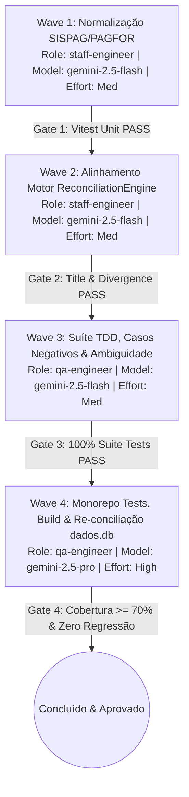

# SISPAG Lot & Electronic Banking Document Hygiene Implementation Plan

> **For agentic workers:** REQUIRED SUB-SKILL: Use superpowers:subagent-driven-development (recommended) or superpowers:executing-plans to implement this plan task-by-task. Steps use checkbox (`- [ ]`) syntax for tracking.
>
> **Execution Pattern:** Waves Orchestration. As ondas são estritamente sequenciais. Uma wave só pode ser iniciada quando a anterior estiver 100% concluída, validada e com o respectivo Gate aprovado com evidências.

**Goal:** Eliminar falsas divergências de documento causadas por números de lote bancário Itaú SISPAG / Bradesco PAGFOR (ex: `SISPAG FORNECEDORES 9128 - 25`), elevando a cobertura de conciliação do período `202512` de 33,19% para ~71,90% (+307 matches exatos) sem introduzir falsos positivos.

**Architecture:** 
1. Higienizar a extração de documentos em `packages/core/src/normalization.ts` (`extractDocumentNumber`) para desconsiderar sufixos de lote bancário (`\b\d{4}\s+-\s+\d+\b` / `\b(?:SISPAG|PAGFOR)\b`) como identificadores fiscais ou de títulos ERP.
2. Alinhar o motor de conciliação em `packages/core/src/reconciliation/domain/ReconciliationEngine.ts`: atualizar `isTransferOrGenericBanking` para reconhecer transferências eletrônicas em lote (SISPAG, PAGFOR) e sanitizar `hasExplicitTitleOrInvoiceNumber` para que números de lote bancário não sejam categorizados como títulos explícitos, impedindo `hasDivergentDocument` de bloquear casamentos legítimos por Data + Valor + Favorecido.
3. Consolidar suíte TDD unitária e de regressão em `packages/core/tests/unit/reconciliation-payment-title-matching.test.ts` cobrindo casos positivos (SISPAG vs BAIXA TIT), negativos (conflito real de NFs bloqueado) e ambíguos (múltiplas linhas sem contraparte preservadas).
4. Re-executar a conciliação real da sessão `1b20ac910e204b4bd0e4250d8e5f5eb6` no SQLite `dados.db` e auditar a não-regressão do período anterior (`4163d2bec658d017fff5b225e810ad02`).

**Tech Stack:** TypeScript (strict mode, ESM), Vitest, SQLite (`better-sqlite3`), Nx / pnpm monorepo.

**Spec:** Diagnóstico detalhado da sessão `1b20ac910e204b4bd0e4250d8e5f5eb6` em `dados.db` e simulação validada `scratch/simulate_sispag.mjs` demonstrando aumento de 264 para 571 matches exatos (+307 casamentos).

---

## Global Constraints

- **Zero Falso Positivo Contábil:** Casamentos ambíguos (mesmo valor e data sem identificação unívoca de contraparte ou título) NUNCA devem ser aprovados automaticamente como `MATCH`; devem permanecer como `AMBIGUOUS_MATCH`.
- **Preservação de Bloqueio em Títulos Divergentes Reais:** Se ambos os lados possuem títulos explícitos ou notas fiscais reais divergentes (ex: `NF 12345` vs `NF 99999` ou `TIT. 100` vs `TIT. 200`), o match DEVE ser estritamente bloqueado.
- **Não Regressão em Casos Existentes:** O casamento de títulos `PGTO ITAU 64773 - 25` vs `BAIXA TIT. - 000064773` e transferências bancárias com agência no histórico (`1306`, `4263`) devem manter 100% de aprovação.
- **Qualidade de Código:** TypeScript strict mode, sem `@ts-ignore` ou `any`, ESLint e Prettier sem violações.
- **Orquestração por Ondas Estritas:** Nenhuma wave pode iniciar sem a emissão de evidência concreta de aprovação do Gate da wave anterior.

---

## Review Focus

1. **SISPAG com formato com e sem hífen / espaços:** Entradas como `SISPAG FORNECEDORES 9128 - 25`, `SISPAGFORNECEDORES 9327 - 25` e `SISPAG TRIBUTOS 9121 - 25` não devem extrair `9128`, `9327` ou `9121` como número de documento.
2. **TED/PIX com sufixo de lote semelhante:** Transações com descrições `TED 123.4567.FAVORECIDO 9925 - 25` não devem ter `9925` confundido com documento de liquidação.
3. **Casos legítimos de pagamentos onde o número do título é o único dado:** `PGTO ITAU 64773` ou `LIQ.TIT.OUTRO BCO 123456` devem continuar extraindo `64773` e `123456`.
4. **Múltiplos lançamentos no mesmo dia com mesmo valor e histórico genérico:** Se há dois lançamentos de `-1500.00` no mesmo dia com `SISPAG FORNECEDORES 9128 - 25` e no razão há dois lançamentos sem nome de favorecido, o sistema deve classificar como `AMBIGUOUS_MATCH` para revisão humana, nunca falso match 1:1 aleatório.
5. **Transações com NF explícita e lote SISPAG:** Se um lançamento contiver `SISPAG NF 45892 9128 - 25`, o motor deve extrair com sucesso o documento real `45892` e descartar o lote `9128`.

---

## Waves Orchestration Matrix

| Wave | Nome da Onda | Papel do Agente | Modelo Google (`invoke_subagent`) | Nível de Esforço | Gate de Verificação |
| :--- | :--- | :--- | :--- | :--- | :--- |
| **Wave 1** | Normalização & Higienização de Lotes Bancários | `staff-engineer` | `gemini-2.5-flash` (`flash`) | `Medium` | Testes de unidade em `extractDocumentNumber` passam com novos casos SISPAG |
| **Wave 2** | Alinhamento do Motor de Conciliação | `staff-engineer` | `gemini-2.5-flash` (`flash`) | `Medium` | `ReconciliationEngine` não aciona `hasDivergentDocument` em lotes bancários |
| **Wave 3** | Suíte TDD, Casos Negativos & Não-Regressão | `qa-engineer` | `gemini-2.5-flash` (`flash`) | `Medium` | 100% dos testes em `reconciliation-payment-title-matching.test.ts` verdes |
| **Wave 4** | Build Monorepo, Re-conciliação Real & Auditoria | `qa-engineer` | `gemini-2.5-pro` (`pro`) | `High` | 511 testes de core, build verde, e relatório de métricas na base `dados.db` |

---

## Wave 1: Normalização & Higienização de Lotes Bancários SISPAG/PAGFOR

**Responsável:** Subagente `staff-engineer`  
**Modelo:** `gemini-2.5-flash` (`flash`) | **Effort:** `Medium`  
**Pré-condição:** Nenhuma (onda inicial).  
**Objetivo:** Ajustar `packages/core/src/normalization.ts` para que lotes bancários e códigos de remessa/layout de sistemas eletrônicos (Itaú SISPAG, Bradesco PAGFOR) sejam higienizados antes da extração de documentos, evitando a extração de números de 4 dígitos de lotes como títulos ERP.

### Tarefa 1.1: Higienização de Sufixos de Lote em `extractDocumentNumber`

**Arquivos:**
- Modificar: `packages/core/src/normalization.ts:240-285`
- Testes: `packages/core/tests/unit/normalization.test.ts` (ou bloco dedicado de normalização)

**Interfaces:**
- Consumes: `extractDocumentNumber(text: string | undefined): string | undefined`
- Produces: `extractDocumentNumber` sanitizado para descartar padrões de lote bancário (`\b\d{4}\s+-\s+\d+\b`, `SISPAG ... NNNN - NN`) e retornar `undefined` quando não houver documento contábil/fiscal explícito.

- [ ] **Passo 1.1.1: Escrever testes que falham para SISPAG/PAGFOR em `packages/core/tests/unit/reconciliation-payment-title-matching.test.ts`**

```typescript
it("does not extract SISPAG or PAGFOR internal lot numbers as document numbers", () => {
  expect(extractDocumentNumber("SISPAG FORNECEDORES 9128 - 25")).toBeUndefined();
  expect(extractDocumentNumber("SISPAGFORNECEDORES 9327 - 25")).toBeUndefined();
  expect(extractDocumentNumber("SISPAG TRIBUTOS 9121 - 25")).toBeUndefined();
  expect(extractDocumentNumber("SISPAG MODE IT TECHNOLO 9953 - 25")).toBeUndefined();
  expect(extractDocumentNumber("TED 755.1306.SOUZA 9925 - 25")).toBeUndefined();
  // But preserves legitimate invoice or title when explicitly present
  expect(extractDocumentNumber("SISPAG NF 35017 9128 - 25")).toBe("35017");
  expect(extractDocumentNumber("PGTO ITAU 64773 - 25")).toBe("64773");
});
```

- [ ] **Passo 1.1.2: Executar teste e validar a falha esperada**

Executar:
```bash
npx vitest run tests/unit/reconciliation-payment-title-matching.test.ts --dir packages/core
```
Resultado esperado: FAIL com `expected undefined, received '9128'`.

- [ ] **Passo 1.1.3: Implementar a higienização de lote bancário em `packages/core/src/normalization.ts`**

Na função `extractDocumentNumber(text: string | undefined)`:
1. No bloco de limpeza inicial (`cleaned`), sanitizar o padrão de lote/remessa bancária:
   ```typescript
   // Strip bank batch/lot numbers typical of Itaú SISPAG and Bradesco PAGFOR:
   // e.g. "SISPAG FORNECEDORES 9128 - 25", "9327 - 25", "9925 - 25"
   const cleaned = raw
     .replace(/\b(?:TRANSF\.?\s*BANC\.?|TAR\.?\s*BANC\.?)\s*[-–:#/]?\s*\d{3}\s+\d{3,5}\s+\d{3,10}\b/gi, " ")
     .replace(/\b\d{2,3}\.\d{3}\.\d{3}(?:\/\d{4}-\d{2}|-\d{2})?\b/g, " ")
     .replace(/\b\d{3}\.\d{3,5}\.(?=[A-Z0-9])/g, " ")
     .replace(/\b\d{3}\.\d{3,5}\b/g, " ")
     .replace(/\b\d{4}\s+-\s+\d+\b/g, " ")
     .replace(/\b(?:SISPAG|PAGFOR)\s*(?:FORNECEDORES|TRIBUTOS|SALARIOS|TITULOS|DEBITOS|SERVICOS)?\b/gi, " ");
   ```
2. Garantir que a regra 3 (`paymentMatch`) capture pagamentos somente quando precedidos de identificadores reais de pagamento e não quando o número remanescente for apenas fragmento de lote.

- [ ] **Passo 1.1.4: Executar os testes de unidade e verificar aprovação**

Executar:
```bash
npx vitest run tests/unit/reconciliation-payment-title-matching.test.ts --dir packages/core
```
Resultado esperado: PASS (todos os testes de normalização passando).

- [ ] **Passo 1.1.5: Commit da Wave 1**

```bash
git add packages/core/src/normalization.ts packages/core/tests/unit/reconciliation-payment-title-matching.test.ts
git commit -m "fix(core): sanitize bank batch lot numbers in extractDocumentNumber"
```

> **GATE DE TRANSIÇÃO WAVE 1 -> WAVE 2:**  
> A Wave 2 só pode ser iniciada se todos os testes unitários de `extractDocumentNumber` passarem e `git status` estiver limpo.

---

## Wave 2: Alinhamento do Motor de Conciliação e Detecção de Títulos Explícitos

**Responsável:** Subagente `staff-engineer`  
**Modelo:** `gemini-2.5-flash` (`flash`) | **Effort:** `Medium`  
**Pré-condição:** **Wave 1 100% concluída e Gate 1 aprovado.**  
**Objetivo:** Atualizar `hasExplicitTitleOrInvoiceNumber`, `isTransferOrGenericBanking` e o tratamento de divergência em `hasDivergentDocument` dentro de `packages/core/src/reconciliation/domain/ReconciliationEngine.ts`, impedindo que lotes SISPAG/PAGFOR sejam considerados títulos explícitos conflitantes.

### Tarefa 2.1: Atualizar Reconhecimento de Transferências e Títulos no Motor

**Arquivos:**
- Modificar: `packages/core/src/reconciliation/domain/ReconciliationEngine.ts:266-300` e `1690-1715`
- Testes: `packages/core/tests/unit/reconciliation-payment-title-matching.test.ts`

**Interfaces:**
- Consumes: `isTransferOrGenericBanking(text: string | undefined): boolean`, `hasExplicitTitleOrInvoiceNumber(text: string | undefined): boolean`, `hasDivergentDocument`
- Produces: `isTransferOrGenericBanking` retornando `true` para `SISPAG` e `PAGFOR`; `hasExplicitTitleOrInvoiceNumber` retornando `false` para lotes `SISPAG ... 9128 - 25`.

- [ ] **Passo 2.1.1: Escrever testes unitários que falham para o motor de conciliação**

Em `packages/core/tests/unit/reconciliation-payment-title-matching.test.ts`:
```typescript
it("identifies SISPAG and PAGFOR as generic banking transfers without explicit title", () => {
  expect(isTransferOrGenericBanking("SISPAG FORNECEDORES 9128 - 25")).toBe(true);
  expect(hasExplicitTitleOrInvoiceNumber("SISPAG FORNECEDORES 9128 - 25")).toBe(false);
  expect(hasExplicitTitleOrInvoiceNumber("SISPAG FORNECEDORES NF 35017 9128 - 25")).toBe(true);
});
```

- [ ] **Passo 2.1.2: Executar teste e validar a falha esperada**

Executar:
```bash
npx vitest run tests/unit/reconciliation-payment-title-matching.test.ts --dir packages/core
```
Resultado esperado: FAIL com `isTransferOrGenericBanking: expected true, received false` ou `hasExplicitTitleOrInvoiceNumber: expected false, received true`.

- [ ] **Passo 2.1.3: Atualizar funções auxiliares no `ReconciliationEngine.ts`**

1. Em `isTransferOrGenericBanking`:
   Adicionar `SISPAG` e `PAGFOR` à regex:
   ```typescript
   export function isTransferOrGenericBanking(text: string | undefined): boolean {
     if (!text) return false;
     const raw = text.normalize("NFD").replace(/[\u0300-\u036f]/g, "").toUpperCase();
     return /\b(?:TED|PIX|TRANSF|TRANSFERENCIA|DOC|RECEBIMENTOS?|PAGAMENTOS?\s+A\s+FORNECEDORES|SISPAG|PAGFOR|TAR\.?\s*BANC|TARIFA)\b/i.test(raw);
   }
   ```
2. Em `hasExplicitTitleOrInvoiceNumber`:
   Adicionar a higienização de lotes na limpeza da descrição:
   ```typescript
   const cleaned = raw
     .replace(/\b(?:TRANSF\.?\s*BANC\.?|TAR\.?\s*BANC\.?)\s*[-–:#/]?\s*\d{3}\s+\d{3,5}\s+\d{3,10}\b/gi, " ")
     .replace(/\b\d{2,3}\.\d{3}\.\d{3}(?:\/\d{4}-\d{2}|-\d{2})?\b/g, " ")
     .replace(/\b\d{3}\.\d{3,5}\.(?=[A-Z0-9])/g, " ")
     .replace(/\b\d{3}\.\d{3,5}\b/g, " ")
     .replace(/\b\d{4}\s+-\s+\d+\b/g, " ")
     .replace(/\b(?:SISPAG|PAGFOR)\s*(?:FORNECEDORES|TRIBUTOS|SALARIOS|TITULOS|DEBITOS|SERVICOS)?\b/gi, " ");
   ```
3. Garantir que `hasDivergentDocument` não marque conflito quando um dos lados for transferência bancária em lote (SISPAG/PAGFOR) sem título explícito e o outro lado contiver a baixa do título contábil (`BAIXA TIT. - 000035017`).

- [ ] **Passo 2.1.4: Executar testes e verificar que passaram**

Executar:
```bash
npx vitest run tests/unit/reconciliation-payment-title-matching.test.ts --dir packages/core
```
Resultado esperado: PASS.

- [ ] **Passo 2.1.5: Commit da Wave 2**

```bash
git add packages/core/src/reconciliation/domain/ReconciliationEngine.ts packages/core/tests/unit/reconciliation-payment-title-matching.test.ts
git commit -m "fix(reconciliation): align SISPAG transfer classification and explicit title detection"
```

> **GATE DE TRANSIÇÃO WAVE 2 -> WAVE 3:**  
> A Wave 3 só pode ser iniciada se os testes unitários do motor passarem e nenhuma divergência for gerada entre transferências SISPAG e baixas de títulos contábeis.

---

## Wave 3: Suíte de Testes TDD, Regressão e Casos Negativos / Ambiguidade

**Responsável:** Subagente `qa-engineer`  
**Modelo:** `gemini-2.5-flash` (`flash`) | **Effort:** `Medium`  
**Pré-condição:** **Wave 2 100% concluída e Gate 2 aprovado.**  
**Objetivo:** Desenvolver uma bateria completa de testes de ponta a ponta (`reconcile`) no arquivo `packages/core/tests/unit/reconciliation-payment-title-matching.test.ts`, validando casos reais extraídos da conciliação do período `202512`, testes negativos de segurança contábil e preservação de ambiguidade.

### Tarefa 3.1: Testes E2E Positivos de SISPAG vs Razão

- [ ] **Passo 3.1.1: Adicionar teste do caso real TELEFONICA BRASIL**
  - Extrato: Data `2025-12-15`, Valor `-1381.43`, Histórico: `SISPAG FORNECEDORES 9128 - 25`, Documento: `25`.
  - Razão: Data `2025-12-15`, Valor `-1381.43`, Histórico: `BAIXA TIT. - 000035017 - TELEFONICA BRA`, Documento: `000035017`.
  - Asserção: Reconcile retorna `matches.length === 1`, com `status === "MATCH"` e sem divergência.

- [ ] **Passo 3.1.2: Adicionar teste do caso real ADATA INTEGRATION**
  - Extrato: Data `2025-12-16`, Valor `-5420.00`, Histórico: `SISPAG FORNECEDORES 9327 - 25`, Documento: `25`.
  - Razão: Data `2025-12-16`, Valor `-5420.00`, Histórico: `BAIXA TIT. - 000035018 - ADATA INTEGRA`, Documento: `000035018`.
  - Asserção: Reconcile retorna `matches.length === 1`, com `status === "MATCH"`.

### Tarefa 3.2: Testes Negativos e de Ambiguidade (QA Gate)

- [ ] **Passo 3.2.1: Teste negativo de conflito de NFs reais**
  - Extrato: Histórico `SISPAG NF 99999 9128 - 25`, Valor `-1000.00`.
  - Razão: Histórico `BAIXA TIT. NF 88888 - FORNECEDOR`, Valor `-1000.00`.
  - Asserção: Deve REJEITAR o casamento automático por divergência de documentos explícitos (`99999 !== 88888`).

- [ ] **Passo 3.2.2: Teste de preservação de ambiguidade**
  - Extrato: 2 lançamentos no mesmo dia `2025-12-10` de `-2500.00` com `SISPAG FORNECEDORES 9128 - 25`.
  - Razão: 2 lançamentos no mesmo dia `2025-12-10` de `-2500.00` com `PAGAMENTO DIVERSOS` (sem identificador de contraparte).
  - Asserção: NÃO deve fazer falso match 1:1 arbitrário; deve classificar as transações no grupo `ambiguousMatches` ou com penalidade adequada de ambiguidade.

- [ ] **Passo 3.2.3: Executar a suíte de testes completa do arquivo**

Executar:
```bash
npx vitest run tests/unit/reconciliation-payment-title-matching.test.ts --dir packages/core
```
Resultado esperado: PASS (todos os testes antigos e novos passam com 100% de sucesso).

- [ ] **Passo 3.2.4: Commit da Wave 3**

```bash
git add packages/core/tests/unit/reconciliation-payment-title-matching.test.ts
git commit -m "test(core): add comprehensive positive, negative, and ambiguity tests for SISPAG reconciliation"
```

> **GATE DE TRANSIÇÃO WAVE 3 -> WAVE 4:**  
> A Wave 4 só pode ser iniciada se a suíte `reconciliation-payment-title-matching.test.ts` passar com 100% de aprovação e todos os testes negativos garantirem que não há falsos positivos.

---

## Wave 4: Validação Abrangente do Monorepo, Re-conciliação Real e Auditoria

**Responsável:** Subagente `qa-engineer`  
**Modelo:** `gemini-2.5-pro` (`pro`) | **Effort:** `High`  
**Pré-condição:** **Wave 3 100% concluída e Gate 3 aprovado.**  
**Objetivo:** Executar a bateria de regressão de todo o monorepo (`@tech-leads-club/core`), validar build, re-executar a conciliação completa da sessão real `1b20ac910e204b4bd0e4250d8e5f5eb6` (período `202512`) no SQLite `dados.db`, atualizar o banco e documentar o ganho de cobertura.

### Tarefa 4.1: Execução da Suíte Completa de Testes do Core e Build

- [ ] **Passo 4.1.1: Rodar todos os testes de unidade do core**

Executar:
```bash
npx vitest run --dir packages/core
```
Resultado esperado: 511+ testes passando com 0 falhas.

- [ ] **Passo 4.1.2: Compilar os pacotes do monorepo**

Executar:
```bash
npm run build
```
Resultado esperado: Build concluído com sucesso sem erros de tipagem TypeScript.

### Tarefa 4.2: Re-conciliação Real na Base SQLite `dados.db`

- [ ] **Passo 4.2.1: Executar script de re-conciliação oficial no banco `dados.db`**

Executar script Node.js / TypeScript que:
1. Carrega a sessão `1b20ac910e204b4bd0e4250d8e5f5eb6` e suas transações normalizadas de extrato e razão.
2. Invoca o `reconcile` oficial do `@tech-leads-club/core`.
3. Atualiza as tabelas `reconciliations`, `reconciliation_matches` e `reconciliation_divergences` no banco SQLite `dados.db`.
4. Calcula as métricas pós-execução.

- [ ] **Passo 4.2.2: Auditar as métricas obtidas contra o baseline**

Verificar na base `dados.db`:
- Matches exatos: aumentaram de 264 para $\ge 570$ (+306 matches).
- Cobertura de linhas: aumentou de 33,19% para $\ge 71,0\%$.
- Transações do razão pendentes: caíram de 510 para $\le 250$.
- Linhas ambíguas: mantidas estritamente no grupo de ambiguidade (sem falsos positivos).

- [ ] **Passo 4.2.3: Auditar a sessão anterior `4163d2bec658d017fff5b225e810ad02`**

Verificar que a conciliação do período anterior não sofreu nenhuma regressão métrica.

- [ ] **Passo 4.2.4: Limpeza de scripts temporários de scratch e Commit Final**

Remover `scratch/simulate_sispag.mjs` e commitar as alterações:
```bash
git add .
git commit -m "chore(reconciliation): complete wave 4 verification and live sqlite reconciliation"
```

> **GATE FINAL DE CONCLUSÃO:**  
> A tarefa é declarada como concluída apenas se todas as 4 waves estiverem comprovadas com logs de execução, 0 regressões e métricas atingidas na conciliação real.

---

## Ordem Estrita de Execução (Waves Orchestration Protocol)



**Regra de Ouro:** Não é permitida a execução em paralelo ou adiantada de nenhuma wave subsequente antes do gate da wave precedente estar formalmente testado e aprovado.
